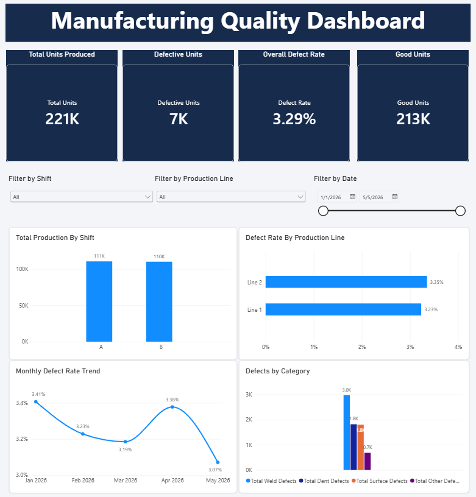
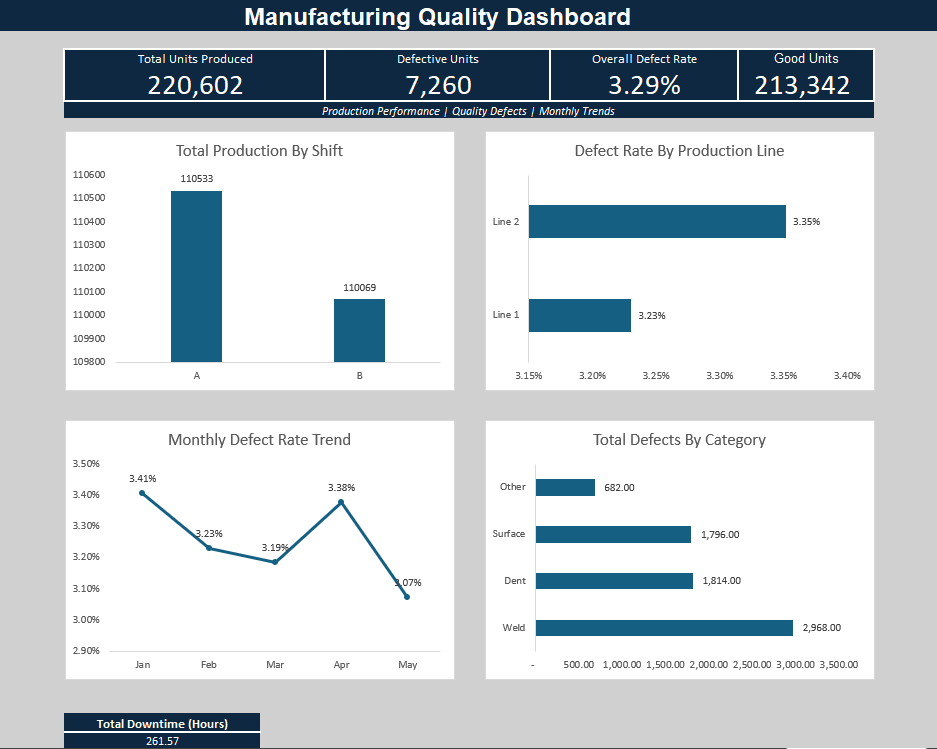

# Manufacturing Quality Analytics Dashboard

## Project Overview

This project analyzes synthetic automotive manufacturing data to evaluate production performance, defect rates, and quality trends across shifts and production lines. I developed dashboards in Microsoft Excel and Power BI to turn production records into useful quality performance metrics.

The goal is to demonstrate how analytics can help manufacturing teams monitor defects, compare performance, and identify opportunities for process improvement.

**Data disclaimer:** This project uses fictional, synthetic data for educational and portfolio purposes. It does not contain confidential or actual production data.

## Tools Used

- Microsoft Excel (formulas, PivotTables, charts)
- Power BI Desktop
- Power Query
- DAX
- CSV

## Key Performance Indicators

- **Total Units Produced:** Total manufacturing output.
- **Defective Units:** Total units recorded as defective.
- **Overall Defect Rate:** Defective units divided by total units produced.
- **Good Units:** Total units produced minus defective units.

## Dashboard Features

Both dashboards show:

1. Total Production by Shift
2. Defect Rate by Production Line
3. Monthly Defect Rate Trend
4. Defects by Category (Weld, Dent, Surface, and Other)

The Power BI dashboard also includes interactive slicers for Shift, Production Line, and Date Range.

## Power BI Dashboard

## Excel Dashboard

## Data Preparation and Analysis

### Excel

- Cleaned and formatted manufacturing production records.
- Created calculated columns for defect rate, good units, and production month.
- Used 'SUM' and 'IFERROR' formulas to calculate quality KPIs.
- Built PivotTables summarizing shift, production line, monthly, and defect-category performance.
- Designed an Excel dashboard with KPI cards and charts.

### Power BI

- Imported the manufacturing dataset from Excel.
- Used Power Query to review and correct data types.
- Created DAX measures for production totals, defective units, defect rate, good units, and defect categories.
- Built interactive charts and slicers.
- Designed a dashboard for monitoring manufacturing quality performance.

## Project Files

| Folder | Contents |
|---|---|
| 'data/' | Synthetic manufacturing dataset (CSV) |
| 'excel/' | Excel workbook, calculations, PivotTables, and dashboard |
| 'powerbi/' | Interactive Power BI report ('.pbix') |
| 'screenshots/' | Excel and Power BI dashboard previews |

## Skills Demonstrated

- Manufacturing quality analytics
- Data cleaning and preparation
- KPI development and DAX calculations
- Excel formulas and PivotTables
- Power Query transformations
- Data visualization and interactive dashboard development
- Production and defect trend analysis

## Future Improvements

- Use SQL to query and analyze the manufacturing dataset.
- Add additional quality metrics, such as downtime by production line.
- Investigate recurring defect patterns and process improvement opportunities.
